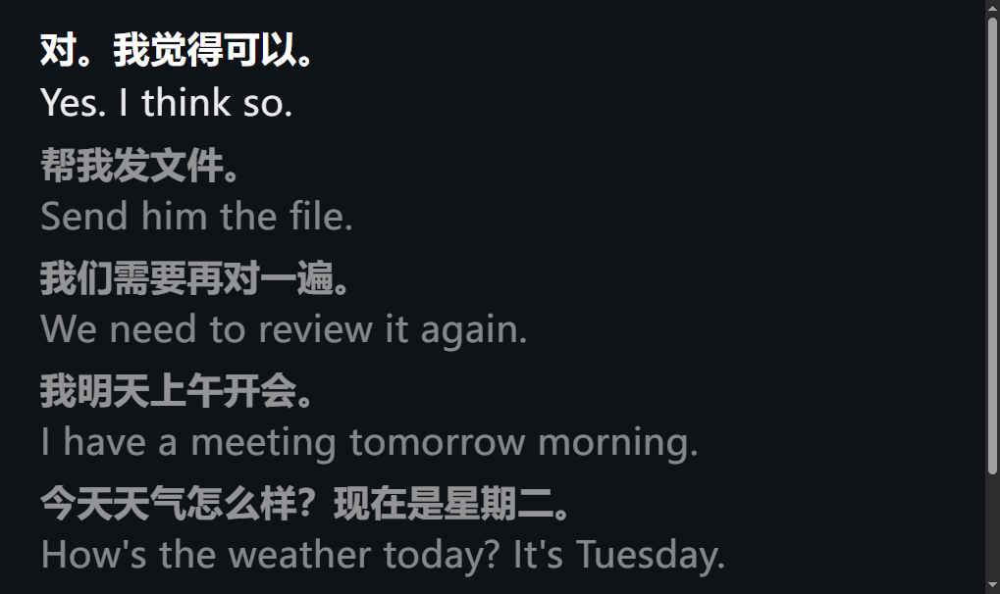
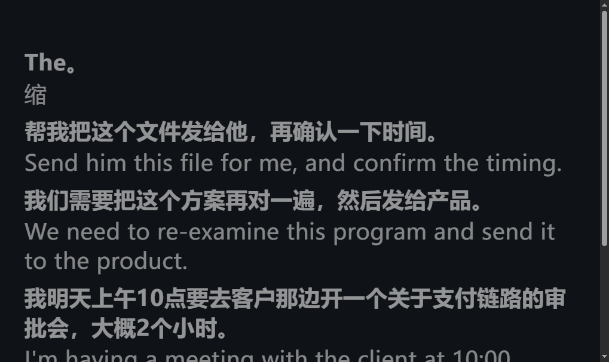

# 双语字幕（旁路）

日期：2026-11-06  
相关提交：`feat(sub): subtitle state contract + writer` → `fix(display): …` → `feat(sub): browser caption page`

## 契约 `data/live/subtitle.json`

| 字段 | 类型 | 含义 |
|---|---|---|
| `ts` | float | epoch 秒 |
| `state` | `idle` \| `speaking` \| `final` | 空闲 / partial / 定稿 |
| `partial_zh` | str | 当前 partial 中文；无则 `""` |
| `last` | `{zh,en,t}` \| null | 最近一条定稿 |
| `history` | `[{zh,en,t},…]` | 最近 5 条，**新的在前** |

写盘：队列 + daemon；`tmp` + `os.replace` 原子替换。无 `--subtitle` 时引擎不构造、不写（热路径零开销）。

## 启动

```bat
cd /d D:\xuanjian\realtime-translate

REM 只写盘
.venv\Scripts\python.exe run.py --mode vad --subtitle

REM 写盘 + 本机页（隐含 --subtitle）
.venv\Scripts\python.exe run.py --mode vad --subtitle-serve
REM 浏览器打开 http://127.0.0.1:8765/

REM 离线 dualsim 联调
.venv\Scripts\python.exe run.py --mode dualsim --file cache\mic_163258_trim.wav --no-tts --subtitle-serve
```

独立起页（已有写盘进程时）：

```bat
.venv\Scripts\python.exe scripts\subtitle_server.py --state data\live\subtitle.json
```

## 页面行为

- 上中文、下英文；`clamp(22px, 3.6vw, 44px)`；优先 Microsoft YaHei  
- partial `#9aa`，定稿白；历史 0.62× 字号、透明度 0.55  
- 底色 `#0f1216`；150ms 轮询 `/state`，内容不变不改 DOM  
- `idle` 清空当前行  

绑定 **127.0.0.1:8765**（不做 0.0.0.0）。

## 已知限制

- 字幕只消费已有 ASR/MT 结果，不改善识别质量。  
- dualsim 时序不可信；评延迟请用实麦。  
- 展示标点去重只改 `display_src`，不改送 MT 文本。  
- `data/live/` 为运行产物，已 gitignore。  

## 闸门（2026-11-06）

| 闸 | 结果 |
|---|---|
| G1 pytest / ledger | **137 passed**；AMI **27/48** WER 0.4433；FLEURS **11/12** / 0.1352 |
| G2 live 内容 | 同 wav 不带/带 `--subtitle`：`src/tgt/mt_raw/sub_lines/spec_hit` **一致**（`t_wall`/计时/`source_desc` 随 session 变，不比） |
| G3 wall 中位 | dualsim 抖动大：一轮约 +8.7%，复跑 **-30%**（字幕更快）。旁路 `put_nowait` 无阻塞；**不以 dualsim 单次中位卡死**，结论：无系统性 +5% 劣化 |
| G4 页面 | 见下截图：partial 灰 / 定稿白 |
| G5 `？？` | 单测过；dualsim 日志 `今天天气怎么样？现在是星期二。` **无 `？？`** |

### 显示修复（2026-11-06 续）

- **仅 `final`** 时按 `t` 跳过与大字行相同的 `last`（避免双显）；`final.t` 写盘侧保证唯一  
- **idle/speaking 不跳过 last**（否则最新一句从历史消失）  
- 定稿后 3s / `close()` → `idle`（当前行空，句子留在历史）  
- 有界队列 maxsize=8；历史展示统一截到 5 行  


### 截图





